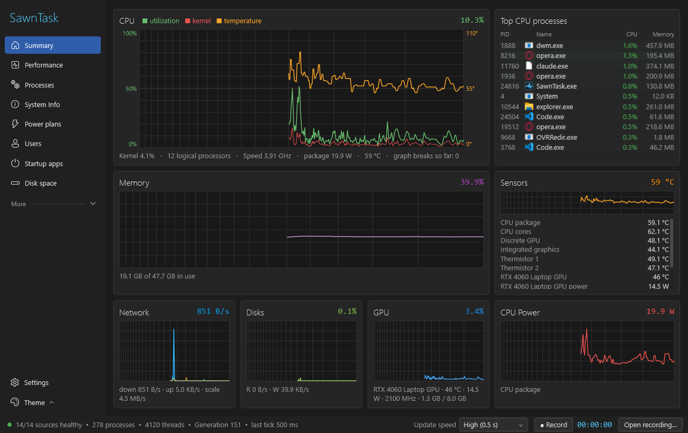
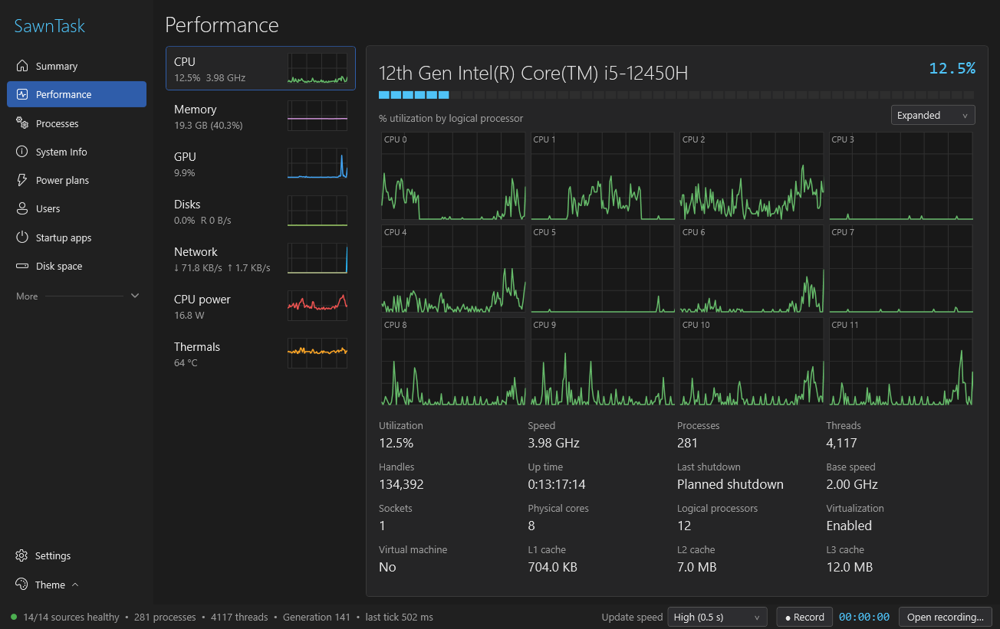
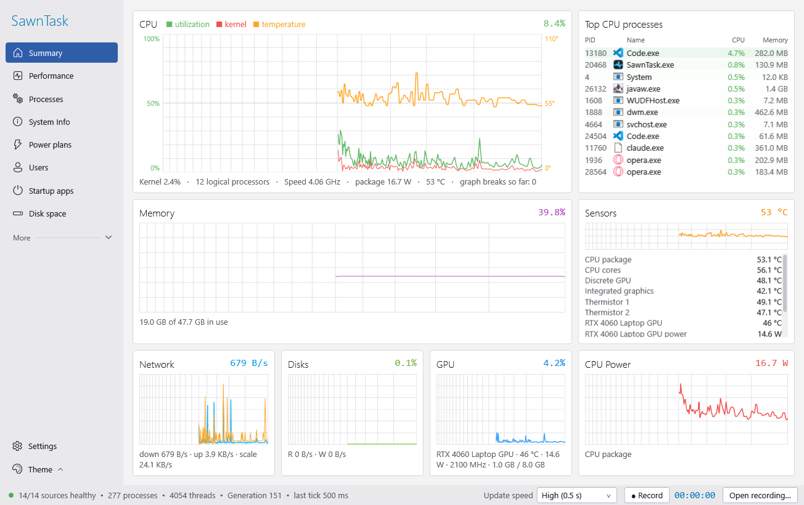
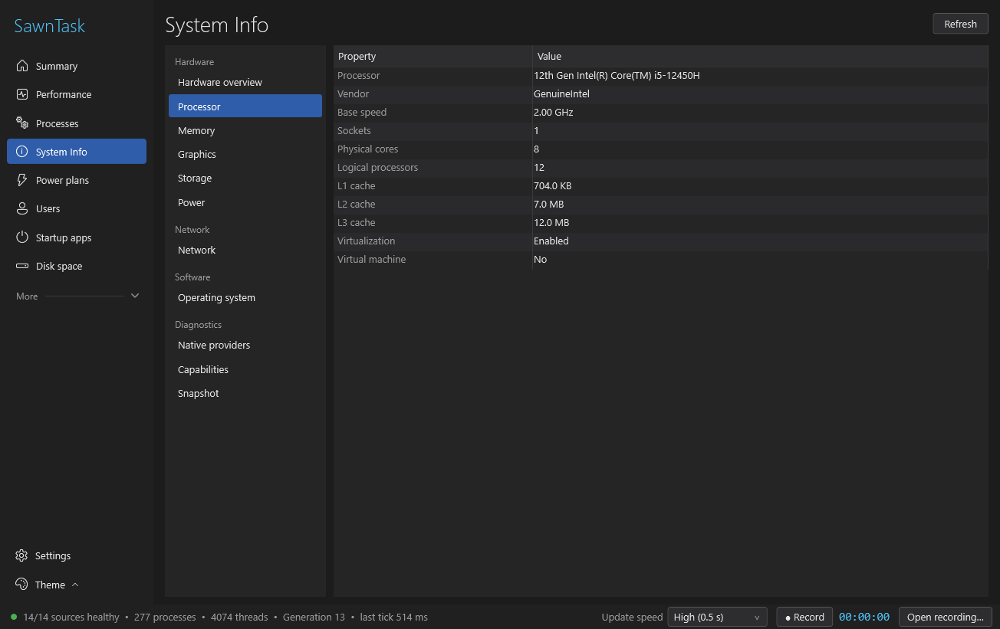
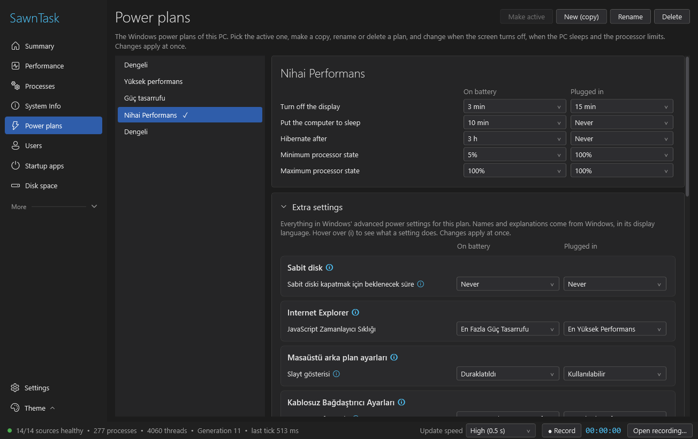

# SawnTask

**What is my computer doing right now, and why?**
A fast, honest system monitor for Windows: live graphs, every process, the hardware inside the
box, and the power plans that decide how it behaves.

[](https://github.com/soldsawn/SawnTask/releases/latest)


[](LICENSE)



> Türkçe açıklama [aşağıda](#türkçe).

---

## Download

| File | What it is |
|---|---|
| **`SawnTask-<version>-setup.exe`** | Installer. Start menu entry, optional desktop icon, clean uninstall. Installs for your user only; no administrator rights needed. |
| **`SawnTask-<version>-portable.exe`** | One file, nothing to install. Put it anywhere (a USB stick works) and run it. |

Both are on the [Releases page](https://github.com/soldsawn/SawnTask/releases/latest), with a
`SHA256SUMS.txt` to check the files against.

- **Needs:** Windows 10 or 11, 64-bit. Nothing else: .NET is built into the exe.
- **First start:** the exe is not code-signed, so Windows SmartScreen may say *"Windows protected
  your PC"*. Choose **More info → Run anyway**. The full source is here if you prefer to build it yourself.
- **Settings** are kept in `%LOCALAPPDATA%\SawnTask\settings.json`. Delete that folder to start fresh.

---

## What it answers

### "Why is my computer slow?"
The **Summary** page shows CPU, memory, disks, network, GPU and CPU power on one screen, plus the
processes using the most CPU right now. The CPU graph keeps the last 600 samples (five minutes
at the fastest update speed): the newest seconds are drawn wide, older minutes are gently
squeezed to the left.
**Drag across the graph** to pick any stretch of time and the list switches to the *average* CPU
use of every process over that stretch. A spike from two minutes ago gets a name.
Hover to see a single moment; click a process to jump to it on the Processes page.

### "Why is it so hot and loud?"
CPU package temperature and power, integrated-graphics and board temperatures come from **Intel
Dynamic Tuning**, the service already installed on most Intel laptops. NVIDIA GPUs report
temperature, power, clocks and memory through **NVML**, NVIDIA's own library. No kernel driver
is installed and no administrator rights are needed.

### "What exactly is inside this PC?"
**System Info** reads the machine itself: processor, cores and caches, each memory module
(size, type, speed, maker), graphics adapters, disks (model, firmware, NVMe or SATA, SSD or HDD),
battery and power plan, network adapters and Windows, including why the PC last shut down
(planned, restart or unexpected).

### "Which power plan am I on, and what does it actually do?"
**Power plans** lists every Windows plan. Switch, copy, rename or delete them, and set when the
screen turns off, when the PC sleeps and the processor limits, on battery and plugged in.
Open **Extra settings** for everything in Windows' *Change advanced power settings* dialog,
grouped as Windows groups them, with an **ⓘ** beside each setting explaining what it does.

### "What is running behind my back?"
**Processes** (grouped into apps and background processes, with icons, users, CPU, memory, disk
I/O, threads and handles; end task, suspend, set priority, open location), **Startup apps**
(enable/disable exactly like Task Manager does), **Services**, **Connections** (every TCP/UDP
socket with its process and who can reach it), **Drivers**, **Installed apps** and **Users**.

### "Where did my disk space go?"
**Disk space** scans a drive or folder in parallel and shows a size-sorted tree, the largest
files and space by file type. Move anything to the Recycle Bin from there, with a warning before
system folders.

---

## Principles

1. **Measured, never invented.** A value that could not be read shows a dash, not a zero. If the
   PC slept or stalled, the graph shows a break instead of drawing a straight line through it.
2. **No admin, no driver.** Everything works as a normal user. Restarting as administrator is
   offered only where Windows truly requires it (some folders, machine-wide startup entries).
3. **One broken source never blanks the others.** Each data source reports its own health on the
   **Sources** page; the status bar counts the healthy ones.
4. **Light.** Graphs redraw only when their picture actually moves by a pixel; hidden pages do
   no drawing work. On a 12-thread laptop the app uses about 1 % of total CPU at a 0.5 s update.
5. **A recycled PID cannot fool it.** Every action re-checks the process's creation time, so
   *End task* never hits a different process that happened to get the same PID.
6. **Readable recordings.** **Record** saves what the graphs show to a plain JSON-lines file;
   **Open recording** replays it later.
7. **Your data stays here.** SawnTask makes no network requests of its own.

---

## Screenshots

| | |
|---|---|
|  |  |
| **Performance:** every logical processor, speed, caches, up time and last shutdown. | **Light theme:** every page follows the Windows-style dark or light theme. |
|  |  |
| **System Info:** the hardware, read from Windows and the firmware. | **Power plans:** basic settings on top, every advanced setting below. |

---

## Everything at a glance

- **Summary:** CPU (utilization, kernel time, temperature, speed), memory, network, disks, GPU,
  CPU power, sensors, top CPU processes; CPU history with period selection.
- **Performance:** CPU, memory, GPU, disks, network, CPU power and thermals with one-minute
  graphs; per-logical-processor graphs (Expanded) or one graph (Combined); CPU statistics.
- **Processes · Users · Connections · Startup apps · Services · Installed apps · Drivers**
- **System Info:** hardware overview, processor, memory, graphics, storage, power, network,
  operating system, diagnostics.
- **Power plans:** plans, basic settings, all advanced settings with explanations.
- **Disk space:** parallel scanner, tree, largest files, file types, Recycle Bin.
- **Settings:** English / Türkçe, dark / light theme, update speed (0.5 s, 1 s, 2 s, paused),
  graph frame rate, smooth curves, start page.

**Limits worth knowing:** temperatures need Intel Dynamic Tuning (most Intel laptops) or an
NVIDIA GPU; AMD CPU and GPU temperatures are not read yet. Machines with more than 64 logical
processors show only the first group. Names and explanations in *Extra settings* come from
Windows, in the Windows display language.

---

## Build from source

Needs the [.NET 9 SDK](https://dotnet.microsoft.com/download/dotnet/9.0).

```powershell
git clone https://github.com/soldsawn/SawnTask.git
cd SawnTask
dotnet run --project src/SawnTask -c Release
```

Release files (portable exe, installer and checksums in `dist\`) also need
[Inno Setup 6](https://jrsoftware.org/isinfo.php) (`winget install JRSoftware.InnoSetup`):

```powershell
powershell -File tools\build-release.ps1
```

Command-line switches for testing:

| Switch | Does |
|---|---|
| `--selftest out.txt` | Runs every data source without a window and writes what each one measured |
| `--sysinfo out.txt` | Writes everything System Info reads |
| `--snapshot out.png [seconds] [page]` | Opens the window, waits, saves a screenshot and exits |

### Layout

```
src/SawnTask/
  Core/        the collector (one thread, one tick), history, settings, recorder, system facts, power plans
  Providers/   one class per data source: CPU, memory, processes, network, disks, GPU, NVIDIA, Intel thermals, ...
  Native/      Windows API declarations and small native readers (SMBIOS, storage, CPU topology, event log)
  Ui/          pages and controls; LineGraph.cs draws every graph
  Strings/     en.xaml and tr.xaml: every text in the app
  Themes/      Dark.xaml, Light.xaml and the shared styles
installer/     Inno Setup script
tools/         build-release.ps1, make_icon.ps1
```

---

## Türkçe

**SawnTask**, Windows için hızlı ve dürüst bir sistem izleyicisi: canlı grafikler, tüm işlemler,
bilgisayarın donanımı ve güç planları tek uygulamada.

**İndirme:** [Releases](https://github.com/soldsawn/SawnTask/releases/latest) sayfasında iki dosya var:
- `SawnTask-<sürüm>-setup.exe`: kurulum. Başlat menüsüne eklenir, temiz kaldırılır, yönetici hakkı istemez.
- `SawnTask-<sürüm>-portable.exe`: kurulumsuz tek dosya, istediğin yerden çalıştır.

Windows 10/11 64-bit yeterli, .NET kurmana gerek yok. Exe imzalı olmadığı için ilk açılışta
SmartScreen uyarısı çıkabilir: **Ek bilgi → Yine de çalıştır**.

**Öne çıkanlar:**
- **Özet:** CPU, bellek, ağ, disk, GPU ve CPU gücü tek ekranda. CPU grafiğinde bir aralığı fareyle
  seçince, o aralıkta en çok CPU kullanan işlemlerin ortalaması listelenir.
- **Sıcaklıklar:** Intel Dynamic Tuning (çoğu Intel dizüstü) ve NVIDIA NVML üzerinden; sürücü
  kurmaz, yönetici hakkı gerektirmez.
- **Performans:** her mantıksal işlemci için ayrı grafik, hız, önbellekler, açık kalma süresi ve
  son kapanma nedeni.
- **Sistem bilgisi:** işlemci, bellek modülleri, ekran kartları, diskler, pil, ağ ve Windows.
- **Güç planları:** planları değiştir, kopyala, yeniden adlandır, sil; **Ekstra ayarlar** altında
  Windows'un tüm gelişmiş güç ayarları, her birinin yanında ne işe yaradığını anlatan **ⓘ** ile.
- **İşlemler, Başlangıç uygulamaları, Hizmetler, Bağlantılar, Sürücüler, Yüklü uygulamalar, Kullanıcılar.**
- **Disk alanı:** klasör ağacı, en büyük dosyalar, dosya türleri, Geri Dönüşüm Kutusu'na taşıma.
- **Arayüz:** Türkçe / İngilizce, koyu / açık tema.

İlke olarak ölçülemeyen değer sıfır yerine çizgiyle (—) gösterilir; bilgisayar uyuduysa grafik
araya düz çizgi çekmek yerine boşluk bırakır. Uygulama kendi başına internete bağlanmaz.

---

## License

[MIT](LICENSE) © 2026 soldsawn
